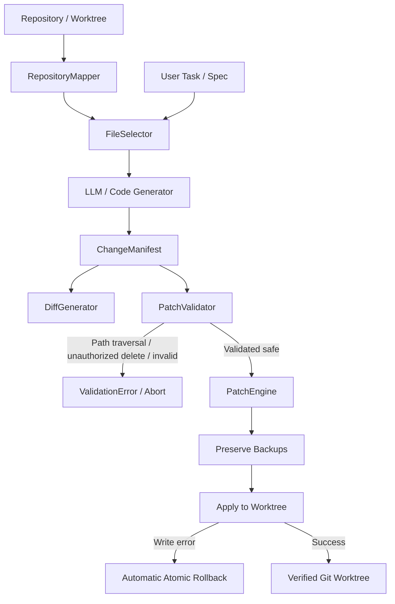

# Hydrameda Repository-Wide Code Engine

> Component: `code_engine/`  
> Test Suite: `tests/test_code_engine.py` (10/10 passed)  
> Full Suite: `tests/` (17/17 passed)

---

## 1. Overview & Objective

The Hydrameda Code Engine replaces restrictive single-module generation (`module.py` and `test_module.py`) with a secure, repository-wide, multi-file code generation and patch application system.

LLMs are **never** permitted to overwrite project files directly. Instead, proposed modifications flow through a formal pipeline:
1. **Repository & Symbol Mapping** (`repository_mapper.py`)
2. **Relevant File Selection** (`file_selector.py`)
3. **Structured Change Manifests** (`change_manifest.py`)
4. **Unified Diff Generation** (`diff_generator.py`)
5. **Pre-Write Patch & Path Validation** (`patch_validator.py`)
6. **Isolated Worktree Application & Rollback** (`patch_engine.py`)

---

## 2. Architecture & Modules



### Module Responsibilities:

| Module | File | Responsibilities |
|---|---|---|
| `change_manifest.py` | [`code_engine/change_manifest.py`](file:///home/daman/hydrameda/code_engine/change_manifest.py) | Data models for `FileOperation` (`CREATE`, `MODIFY`, `DELETE`), `FileChange`, and `ChangeManifest`. Computes SHA-256 hashes and serializes to/from JSON. |
| `repository_mapper.py` | [`code_engine/repository_mapper.py`](file:///home/daman/hydrameda/code_engine/repository_mapper.py) | Tree-sitter and AST symbol extraction (classes, methods, functions, imports, internal & external dependencies). Produces compressed skeletons for prompt injection. |
| `file_selector.py` | [`code_engine/file_selector.py`](file:///home/daman/hydrameda/code_engine/file_selector.py) | Lexical and symbol intersection scoring to select top-k relevant files and identify dependent modules for a task. |
| `diff_generator.py` | [`code_engine/diff_generator.py`](file:///home/daman/hydrameda/code_engine/diff_generator.py) | Standard GNU/Git unified diff generation (`difflib`) for individual files and entire manifests. Computes line additions/deletions stats. |
| `patch_validator.py` | [`code_engine/patch_validator.py`](file:///home/daman/hydrameda/code_engine/patch_validator.py) | Enforces strict path traversal protection (`..`, absolute paths), worktree boundary containment, protected path shielding (`.git`, `.env`), pre-state consistency (CREATE on non-existent, MODIFY on existent, hash matching), and requires explicit authorization for destructive DELETE operations. |
| `patch_engine.py` | [`code_engine/patch_engine.py`](file:///home/daman/hydrameda/code_engine/patch_engine.py) | Pre-validates changes, creates temporary file backups, applies multi-file operations inside the worktree, and provides both automatic atomic rollback on failure and manual rollback (`rollback_manifest`). |

---

## 3. Security & Safety Rules

1. **Path Traversal Protection**: Any path containing `..`, leading `/` or `\`, or resolving outside the target worktree boundary is immediately rejected with a `ValidationError`.
2. **Protected File Shielding**: Files such as `.git`, `.env`, `.env.local`, `docker-compose.yml`, and `Dockerfile.verifier` cannot be modified by generated patches.
3. **Destruction Authorization**: `DELETE` operations require explicit authorization (`authorized=True` or `allow_delete=True`); unauthorized deletions are blocked.
4. **Original File Preservation**: Before modifying or deleting any file on disk, a backup copy is saved in a secure temporary directory (`/tmp/hydrameda_backup_...`).
5. **Pre-Write Disk Validation**: Every file change in a multi-file manifest is checked before any file is touched. If file #3 is invalid, files #1 and #2 are never touched.
6. **Atomic Rollback**: If an I/O error occurs mid-application, all previously applied changes in the manifest are restored from backup in reverse order.

---

## 4. Test Suite Coverage

A comprehensive test suite in [`tests/test_code_engine.py`](file:///home/daman/hydrameda/tests/test_code_engine.py) validates all 10 required operational and security scenarios:

| Test Name | Verifies | Result |
|---|---|---|
| `test_new_file_creation` | Creating new files in nested paths (`CREATE`) | ✅ PASSED |
| `test_existing_file_modification` | Modifying existing files on disk (`MODIFY`) | ✅ PASSED |
| `test_authorized_deletion` | Deleting files with explicit `authorized=True` | ✅ PASSED |
| `test_unauthorized_deletion_rejected` | Blocking `DELETE` operations without authorization | ✅ PASSED |
| `test_multiple_file_modifications` | Atomic multi-file changesets across multiple directories | ✅ PASSED |
| `test_path_traversal_attempts_rejected` | Rejecting `../`, `/etc/hosts`, and `.env` traversal attempts | ✅ PASSED |
| `test_invalid_patches` | Rejecting `CREATE` on existing, `MODIFY` on missing, hash mismatches | ✅ PASSED |
| `test_manual_and_atomic_rollback` | Restoring disk state from backups after application | ✅ PASSED |
| `test_git_diff_accuracy` | Accurate Git-compatible unified diffs and addition/deletion statistics | ✅ PASSED |
| `test_repository_mapper_and_selector` | Tree-sitter mapping and relevant file selection by symbol intersection | ✅ PASSED |

**Complete Test Suite Execution (Code Engine + LangGraph Engine):**
```bash
/home/daman/hydrameda/.venv/bin/pytest -v tests/
============================= 17 passed in 15.63s =============================
```
