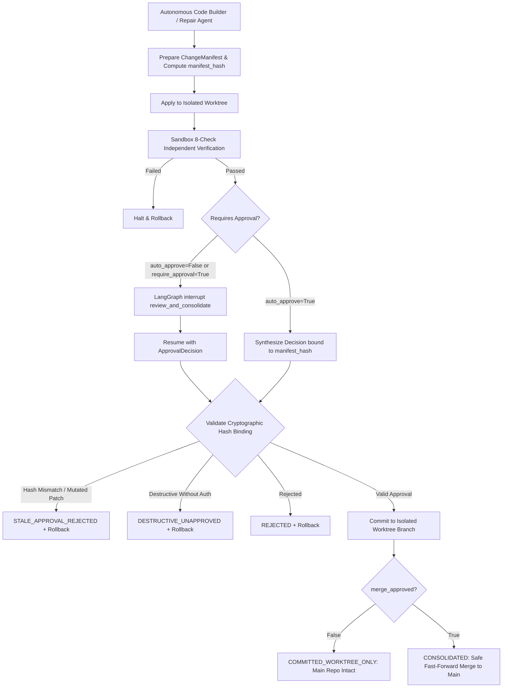

# Hydrameda: Human-in-the-Loop Governance & Safe Change Consolidation

## Executive Overview

Hydrameda's governance and consolidation layer enforces deterministic safety invariants between autonomous code generation and version-controlled repository state. It guarantees that **no unreviewed, unverified, or mutated change can ever reach the main repository branch**.

---

## Core Invariants and Guarantees



### 1. Cryptographic Change-Set Hash Binding
Every proposed change-set is encapsulated in a `ChangeManifest` whose `manifest_hash` property computes a SHA256 digest over the sorted canonical representation of all target file paths, operations (`CREATE`, `MODIFY`, `DELETE`), proposed hashes, and original hashes:
$$\text{manifest\_hash} = \text{SHA256}\left(\sum_i \text{path}_i : \text{op}_i : \text{proposed\_hash}_i : \text{original\_hash}_i\right)$$

### 2. Automatic Stale Approval Revocation
Approval decisions (`ApprovalDecision`) must contain `approved_manifest_hash`. If a human approves an initial patch, but a subsequent repair cycle or code modification mutates any file content, operation, or path, the `manifest_hash` changes:
$$\text{approved\_manifest\_hash} \neq \text{current\_manifest\_hash} \implies \text{STALE\_APPROVAL\_REVOCATION}$$
The governance engine invalidates the approval, halts consolidation, and executes an automated disk rollback.

### 3. Risk Classification Framework
The `GovernanceEngine.assess_risk()` classifies changes into 4 tiered risk categories:

| Level | Criteria | Required Authorizations |
| :--- | :--- | :--- |
| **LOW** | 1-2 files created or cleanly modified, no critical files, verification passed | Standard approval |
| **MEDIUM** | 3-5 files modified, no critical files, verification passed | Standard approval |
| **HIGH** | >5 files affected, or modifications to critical infrastructure (`pyproject.toml`, `setup.py`, `Dockerfile`, `.github/`) | Elevated review |
| **CRITICAL** | Contains destructive operations (`DELETE`), or deterministic verification failed | Requires explicit `destructive_approved=True` |

### 4. Destructive Operation Protection
Any change containing a `DELETE` operation is classified as `CRITICAL` risk and requires explicit `destructive_approved=True` in the approval decision. Without this flag, consolidation is rejected immediately.

### 5. Main Branch Isolation
Under no circumstances are generated files copied into the main project root.
- If `merge_approved=False`: Changes are committed strictly inside the isolated Git worktree branch (`hydrameda/{task_id}`). The main repository working tree and HEAD are preserved intact.
- If `merge_approved=True`: The verified worktree branch is merged into the main repository using standard Git version control (`git merge --no-ff`).

### 6. Automated Rollback on Rejection or Tampering
When consolidation fails, is rejected, or encounters a stale approval, `SafeConsolidator` uses `PatchEngine.rollback_manifest()` to restore original files from disk backups created prior to patch application.

---

## Data Models

### `ApprovalDecision`
```python
@dataclass
class ApprovalDecision:
    approved: bool = False
    approved_manifest_hash: Optional[str] = None
    approver: str = "human"
    timestamp: str = field(default_factory=...)
    destructive_approved: bool = False
    merge_approved: bool = False
    comments: Optional[str] = None
```

### `ConsolidationReport`
```python
@dataclass
class ConsolidationReport:
    task_id: str
    status: str  # "CONSOLIDATED" | "COMMITTED_WORKTREE_ONLY" | "REJECTED" | "ROLLED_BACK" | "STALE_APPROVAL_REJECTED" | "VERIFICATION_FAILED"
    approved: bool
    merged_to_main: bool
    worktree_commit: Optional[str] = None
    main_commit: Optional[str] = None
    final_diff: Optional[str] = None
    manifest_hash: Optional[str] = None
    risk_level: Optional[str] = None
    files_affected: List[str] = field(default_factory=list)
    summary: str = ""
    timestamp: str = field(default_factory=...)
```

---

## LangGraph Human-in-the-Loop Integration

In Node 12 (`node_consolidator`), when `auto_approve` is `False` or `require_consolidation_approval` is `True`, LangGraph triggers an `interrupt()`:

```python
resume_val = interrupt({
    "action": "review_and_consolidate",
    "task_id": state.get("task_id"),
    "review_display": review_display,
    "manifest_hash": manifest.manifest_hash,
    "risk_level": risk.level.value,
    "affected_files": manifest.target_files,
    "unified_diff": manifest.unified_diff,
    "verification_passed": is_verified,
    "question": "Approve change consolidation into repository? [approved: True/False, destructive_approved: True/False, merge_approved: True/False]"
})
```

Resumption is performed via LangGraph Command:
```python
final_state = app.invoke(
    Command(resume={
        "approved": True,
        "approved_manifest_hash": manifest_hash,
        "destructive_approved": False,
        "merge_approved": False
    }),
    config
)
```

---

## Verification & Test Matrix

The test suite in [`tests/test_governance.py`](file:///home/daman/hydrameda/tests/test_governance.py) validates all governance requirements:

| Test Case | Description | Result |
| :--- | :--- | :---: |
| `test_risk_classification_levels` | Evaluates LOW, MEDIUM, HIGH, CRITICAL risks | **PASSED** |
| `test_format_review_display` | Verifies review markdown display components | **PASSED** |
| `test_cryptographic_approval_validation_success` | Verifies matching SHA256 approval validation | **PASSED** |
| `test_cryptographic_approval_stale_hash_revocation` | Verifies mutated code revokes stale approval | **PASSED** |
| `test_destructive_operation_protection` | DELETE requires `destructive_approved=True` | **PASSED** |
| `test_unverified_code_cannot_be_consolidated` | Verification failure blocks consolidation | **PASSED** |
| `test_safe_consolidation_worktree_only_when_merge_not_approved` | Main repo untouched when merge unapproved | **PASSED** |
| `test_safe_consolidation_merge_to_main_when_approved` | Safe Git merge to main when merge approved | **PASSED** |
| `test_rejection_triggers_automatic_rollback` | Rejection restores disk backup cleanly | **PASSED** |
| `test_stale_approval_triggers_automatic_rollback` | Stale hash halts and rolls back changes | **PASSED** |
| `test_langgraph_consolidation_interrupt_and_resume` | Interrupted execution resumes on approval | **PASSED** |
| `test_langgraph_consolidation_rejection_halts_execution` | Interrupted execution halts on rejection | **PASSED** |
