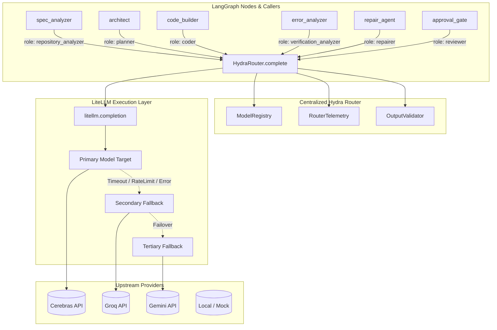

# Hydrameda Centralized Multi-Model Hydra Router

The **Hydra Router** (`hydra_router/`) serves as the single model access layer for all LangGraph nodes, integrations, and automated agents across the Hydrameda ecosystem. It replaces ad-hoc direct API calls with centralized role-based routing, intelligent fallback chains, structured output validation, token usage tracking, and high-precision latency telemetry powered by **LiteLLM**.

---

## 1. Architecture Overview



---

## 2. Supported Roles

Every model request is explicitly typed with a `ModelRole`. Custom roles and legacy aliases are normalized automatically:

| Role Enum | Canonical Name | Responsibility | Default Fallback Chain |
|---|---|---|---|
| `ModelRole.PLANNER` | `planner` | System architecting & specification synthesis | `groq/openai/gpt-oss-120b` $\rightarrow$ `cerebras/gpt-oss-120b` $\rightarrow$ `gemini/gemini-2.5-pro` |
| `ModelRole.REPOSITORY_ANALYZER` | `repository_analyzer` | AST intent analysis & repository mapping | `cerebras/gpt-oss-120b` $\rightarrow$ `groq/openai/gpt-oss-120b` |
| `ModelRole.CODER` | `coder` | Autonomous code & test suite generation | `cerebras/gpt-oss-120b` $\rightarrow$ `groq/openai/gpt-oss-120b` |
| `ModelRole.REPAIRER` | `repairer` | Targeted self-healing repair patches | `groq/openai/gpt-oss-120b` $\rightarrow$ `cerebras/gpt-oss-120b` |
| `ModelRole.VERIFICATION_ANALYZER` | `verification_analyzer` | Neuro-symbolic error diagnosis | `cerebras/gpt-oss-120b` $\rightarrow$ `groq/openai/gpt-oss-120b` |
| `ModelRole.REVIEWER` | `reviewer` | Spec evaluation & human-in-the-loop audit | `groq/openai/gpt-oss-120b` $\rightarrow$ `cerebras/gpt-oss-120b` |

### Legacy Aliases
- `hybrid-architect`, `architect`, `spec_researcher` $\rightarrow$ `planner`
- `hybrid-coder`, `default`, `code_builder` $\rightarrow$ `coder`
- `healer`, `repair_agent` $\rightarrow$ `repairer`
- `error_analyzer` $\rightarrow$ `verification_analyzer`

---

## 3. Configuration & Environment Overrides

The router automatically loads provider keys from environment variables and the local `.env` file (`HYDRAMEDA_ROOT/.env`):

- `GROQ_API_KEY`
- `CEREBRAS_API_KEY`
- `GEMINI_API_KEY`
- `OPENAI_API_KEY`
- `ANTHROPIC_API_KEY`

### Model Selection Overrides
Individual roles can be overridden dynamically at runtime without modifying code:

```bash
# Override the coder role to use custom models
export HYDRAMEDA_CODER_MODEL="cerebras/llama-3.3-70b,groq/openai/gpt-oss-120b"

# Override the planner role
export HYDRAMEDA_PLANNER_MODEL="groq/llama-3.3-70b-versatile,gemini/gemini-2.5-pro"
```

### Configurable Provider Endpoints
Base URLs can be redirected to custom proxies or local models:
- `CEREBRAS_API_BASE`
- `GROQ_API_BASE`
- `GEMINI_API_BASE`

---

## 4. Resilience & Error Handling

1. **Timeout Handling**: Every model spec defines a bounded request timeout (default 30–45s). When a timeout occurs, the router records the failure latency in telemetry and immediately fails over to the next candidate in the chain.
2. **Rate-Limit Handling (HTTP 429)**: When rate limits occur, the router pauses briefly and fails over to the next provider target.
3. **No Silent Failures**: If all candidates in the role's chain fail, the router raises `AllModelsFailedError`, providing a structured log of every attempt.
4. **Deterministic Verification Isolation**: Deterministic verification (`sandbox_verifier` with rootless Docker, ruff, mypy, bandit, pytest) remains strictly separate from LLM-assisted verification analysis (`ModelRole.VERIFICATION_ANALYZER`), preventing hallucinated test passes.

---

## 5. Structured Output Validation

The router provides pluggable output validation through `OutputValidator`:

- **Pydantic Validation**:
  ```python
  from pydantic import BaseModel
  from hydra_router import get_router, ModelRole, OutputValidator

  class TaskPlan(BaseModel):
      summary: str
      steps: list[str]

  resp = get_router().complete(
      role=ModelRole.PLANNER,
      prompt="Plan the migration",
      validator=OutputValidator.validate_pydantic(TaskPlan)
  )
  print(resp.parsed.summary)
  ```
- **XML Tag Blocks**: `OutputValidator.validate_xml_files(min_files=1)` ensures code responses contain well-formed `<file name="...">` tags.
- **Markdown Specification**: `OutputValidator.validate_markdown_spec(required_headings=[...])` verifies specification structure.

---

## 6. Telemetry & Performance Tracking

Every completed model call is recorded with high-resolution latency and token usage:

```python
from hydra_router import get_router

router = get_router()
summary = router.telemetry.get_summary()

print(f"Total Calls: {summary['total_calls']}")
print(f"Success Rate: {summary['success_rate']:.1%}")
print(f"Average Latency: {summary['average_latency_ms']} ms")
print(f"Total Tokens: {summary['tokens']['total']}")
print(f"Fallback Events: {summary['fallback_events']}")
```
