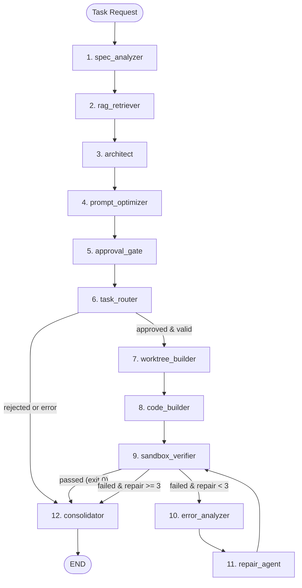

# Hydrameda 12-Node Neuro-Symbolic LangGraph Orchestration Engine

> Updated: 2026-11-08  
> Component: `langgraph_engine/graph.py`  
> Test Suite: `tests/test_graph.py` (7/7 passed)

---

## 1. Executive Summary

The Hydrameda orchestration engine has been upgraded from a coarse 4-node pipeline into a modular, 12-node neuro-symbolic cyclic execution engine built on LangGraph 1.2.18.

Key architectural improvements:
- **Strongly Structured Shared State (`HydramedaState`)**: Explicitly typed fields with well-defined inputs and outputs for every node.
- **Human-in-the-Loop Governance (`approval_gate`)**: Native LangGraph `interrupt()` and `Command(resume=...)` support for specification review, with automatic bypass via `--auto-approve`.
- **Neuro-Symbolic Self-Healing Loop**: Specialized `error_analyzer` categorizes failures (syntax, imports, types, security, assertions), guiding the `repair_agent`.
- **Bounded Cyclic Execution**: The self-healing loop is strictly hard-capped at a maximum of three repair attempts (`repair_count <= 3`), provably preventing infinite execution loops.
- **Fail-Safe Security Isolation**: Verification failures cannot enter the success path. Git auto-commit occurs only on verified success (`status == "PASSED" and verifier_exit_code == 0`) with approved status.
- **Rootless Sandbox Verification**: Strict container isolation with `--network none`, `--cap-drop ALL`, `--read-only`, and tmpfs memory limits.

---

## 2. 12-Node Architecture Map



---

## 3. Node Specifications & Contracts

### Node 1: `spec_analyzer`
- **Role**: Parses prompt requirements, extracts AST repository signatures using Tree-sitter.
- **Inputs**: `user_prompt`, `repo_path`, `task_id`
- **Outputs**: `task_analysis` (intent, keywords, constraints), `ast_skeleton`
- **Exception Handling**: Explicitly catches empty prompts or parse failures, logs structured error, sets `state["error"]` and `state["status"] = "ERROR"`.

### Node 2: `rag_retriever`
- **Role**: Queries LanceDB + FastEmbed over the Obsidian Vault for system invariants and past lessons.
- **Inputs**: `user_prompt`, `task_analysis`
- **Outputs**: `vault_context`
- **Exception Handling**: Catches vector database or filesystem errors, falls back to empty context without crashing.

### Node 3: `architect`
- **Role**: Synthesizes formal Markdown technical specification defining public API contracts and invariants.
- **Inputs**: `user_prompt`, `task_analysis`, `vault_context`, `ast_skeleton`, `task_id`
- **Outputs**: `spec_md`, writes to `ObsidianVault/Specs/{task_id}.md`
- **Model**: `hybrid-architect` (max 4096 tokens).

### Node 4: `prompt_optimizer`
- **Role**: Compiles and injects epistemic guards, stdlib boundaries, and XML schema instructions for code generation.
- **Inputs**: `spec_md`, `task_analysis`, `ast_skeleton`
- **Outputs**: `optimized_prompt`

### Node 5: `approval_gate`
- **Role**: Human-in-the-loop review point.
- **Inputs**: `spec_md`, `task_id`, `auto_approve`, `approval_status`
- **Outputs**: `approval_status` (`"APPROVED"` | `"REJECTED"`)
- **Behavior**: If `auto_approve` is true or status is already `"APPROVED"`, passes without interruption. Otherwise, invokes LangGraph `interrupt(...)`. Resumes when supplied with `Command(resume={"approved": bool})`.

### Node 6: `task_router`
- **Role**: Evaluates approval and error states, branching execution path.
- **Inputs**: `approval_status`, `error`, `status`
- **Outputs**: `route` (`"execute"` | `"cancel"`), `status`

### Node 7: `worktree_builder`
- **Role**: Provisions a dedicated Git worktree branch (`hydrameda/{task_id}`) for zero side-effect execution.
- **Inputs**: `repo_path`, `task_id`
- **Outputs**: `worktree_path`

### Node 8: `code_builder`
- **Role**: Autonomous code and test suite generator with deterministic AST import healing.
- **Inputs**: `optimized_prompt`, `spec_md`, `worktree_path`
- **Outputs**: `current_files`, `target_files`, `repair_count = 0`, `retry_count = 0`
- **Model**: `hybrid-coder` (max 8192 tokens).

### Node 9: `sandbox_verifier`
- **Role**: Executes verification inside rootless Docker container (`--network none`, `--cap-drop ALL`, `--read-only`, tmpfs).
- **Gating**: Ruff (syntax/undefined names) -> Mypy strict -> Bandit SAST -> Pytest suite.
- **Inputs**: `worktree_path`, `target_files`, `repair_count`
- **Outputs**: `verifier_output`, `pytest_stderr`, `verifier_exit_code`, `status` (`"PASSED"` | `"FAILED"`)

### Node 10: `error_analyzer`
- **Role**: Symbolic error categorization and traceback parsing.
- **Inputs**: `pytest_stderr`, `verifier_output`, `current_files`, `repair_count`
- **Outputs**: `error_analysis` (`category`, `summary`, `failed_tests`, `actionable_guidance`)
- **Categories**: `SYNTAX_ERROR`, `IMPORT_ERROR`, `TYPE_ERROR`, `SECURITY_ERROR`, `ASSERTION_FAILURE`, `RUNTIME_ERROR`.

### Node 11: `repair_agent`
- **Role**: Targeted repair of broken code and tests using failure diagnosis and previous attempt context.
- **Inputs**: `spec_md`, `current_files`, `error_analysis`, `pytest_stderr`, `repair_count`, `worktree_path`
- **Outputs**: `current_files`, `target_files`, `repair_count` (incremented), `retry_count`
- **Loop**: Recursively routes back to `sandbox_verifier`.

### Node 12: `consolidator`
- **Role**: Finalization, version control commitment, and knowledge consolidation.
- **Inputs**: `status`, `approval_status`, `worktree_path`, `task_id`, `user_prompt`, `repair_count`, `target_files`
- **Outputs**: `commit_hash`, `final_report`, `status`
- **Safety**: Commits to Git only if `status == "PASSED"` and `approval_status == "APPROVED"`. Writes markdown report to `Lessons-Learned/{task_id}-report.md` and syncs LanceDB.

---

## 4. Conditional Edge Logic

```python
def route_after_task_router(state: HydramedaState) -> str:
    # If errors occurred in earlier planning nodes or human rejected, bypass build
    if not state.get("error") and state.get("approval_status") == "APPROVED" and state.get("route") == "execute":
        return "worktree_builder"
    return "consolidator"

def route_after_verifier(state: HydramedaState) -> str:
    # Strict safety: Only verified exit code 0 enters success consolidation
    if state.get("status") == "PASSED" and state.get("verifier_exit_code") == 0:
        return "consolidator"

    # Enforce hard cap of 3 repair attempts (initial attempt + 3 repairs = 4 verifier runs)
    repairs = state.get("repair_count", 0)
    if repairs < 3:
        return "error_analyzer"

    # Max repair attempts exhausted
    state["status"] = "FAILED"
    return "consolidator"
```

---

## 5. Test Suite Verification

The engine is validated against a 7-part automated test suite in [`tests/test_graph.py`](file:///home/daman/hydrameda/tests/test_graph.py):

| Test Case | Scenario | Expected Outcome | Result |
|---|---|---|---|
| `test_successful_execution` | Verifier succeeds on initial attempt (Pass@1) | `status == "PASSED"`, `repair_count == 0`, committed | ✅ PASSED |
| `test_verification_failure_cannot_enter_success_path` | Verifier continuously fails | `status == "FAILED"`, `commit_hash == "N/A"`, uncommitted | ✅ PASSED |
| `test_repair_success` | Verifier fails on attempt 0, succeeds on repair attempt 1 | `status == "PASSED"`, `repair_count == 1`, committed | ✅ PASSED |
| `test_three_failed_repair_attempts` | Verifier fails across all 3 repair cycles | Exactly 4 verifier runs, `repair_count == 3`, `status == "FAILED"` | ✅ PASSED |
| `test_human_rejection` | Specification rejected at approval gate | `approval_status == "REJECTED"`, 0 files generated | ✅ PASSED |
| `test_interrupted_execution_and_resume` | State pauses at approval gate, resumes via Command | Successful interrupt snapshot and resumption | ✅ PASSED |
| `test_node_exception_handling` | Invalid prompt triggers node exception | Caught gracefully, `status == "ERROR"`, error logged | ✅ PASSED |

**Test Execution Telemetry:**
```bash
/home/daman/hydrameda/.venv/bin/pytest -v /home/daman/hydrameda/tests/test_graph.py
============================== 7 passed in 15.53s ==============================
```
